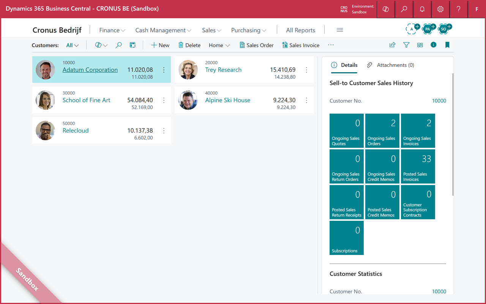
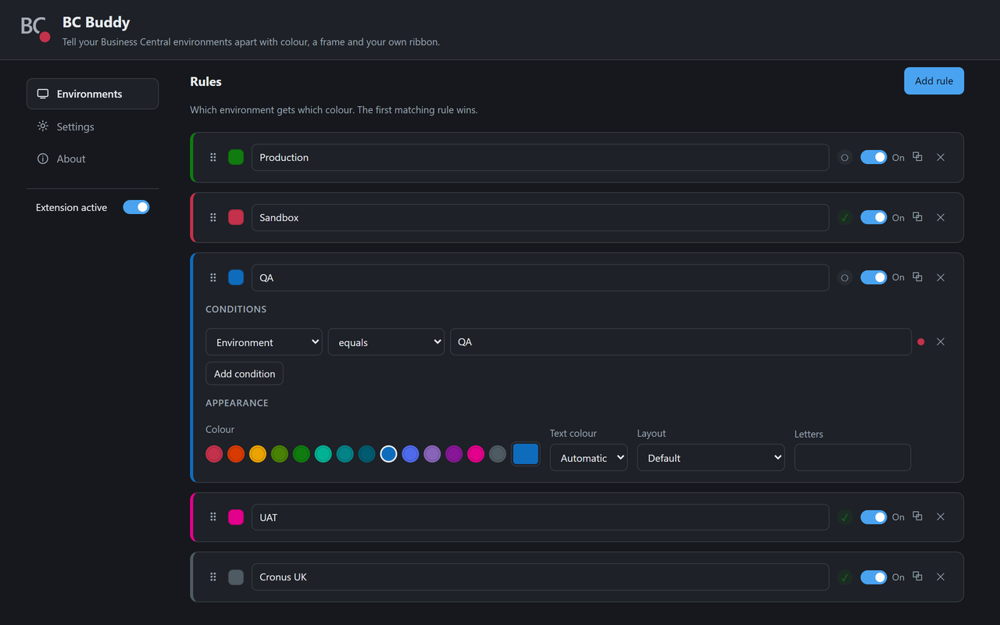
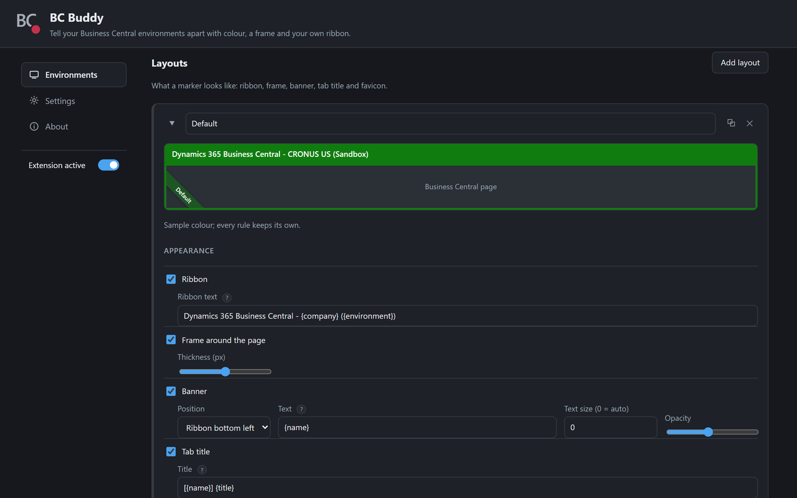

# BC Buddy

> **Business Central, easier to work in** ✨

BC Buddy is a free extension for Chrome and Edge. It makes the Business Central
web client easier to work in, and gives every environment its own colour, so
you never post in production by mistake.

- **An easier web client**, straight away: copy any value with one click, wide
  pages, bigger dropdowns, week numbers in the date picker and more.
- **A colour for every environment**: production green, sandbox red, or
  whatever suits you.

Full documentation: **<https://fvet.github.io/bcbuddy/>** · What's new in each
version: [CHANGELOG.md](CHANGELOG.md)

## 📥 Installing

Install it from the
[Chrome Web Store](https://chromewebstore.google.com/detail/bc-buddy/jpgpcfecpdcocjlepdfceahamliimjdl)
and click **Add to Chrome**. Edge first asks whether to allow extensions from
other stores; say yes. You need Chrome or Edge 111 or newer.

## 🚀 Getting started

1. **Install BC Buddy.** Its settings page opens by itself. Later, click the
   BC Buddy icon in the toolbar to open it again, or in Business Central click
   the gear icon at the top right and choose **Settings** under **BC Buddy**.
2. **Open Business Central**, or reload a tab where it was already open. The
   web client improvements below are already working.
3. **Give your environments a colour.** On the settings page, go to
   **Environments**, click **Add rule**, name it `PRODUCTION`, set the
   condition **Environment** **equals** `Production` and pick green. Add a
   second rule for `Sandbox` in red.

Not sure what your environment is called? Click **From open tab** at the top
of **Environments**: BC Buddy reads your open Business Central tab and shows
its environment and company.

## 🖥️ Web client

No setup needed. Each improvement has its own switch under **Web client** on
the settings page.

| Improvement | What you get in Business Central | Starts |
|---|---|---|
| **Copy values** | A copy icon on any value in a list or FactBox, and on links on a card | On |
| **Maximize pages** | Every page in wide layout, tile pages as a list | On |
| **Pin the action bar** | Every page opens with the row of actions under its tabs pinned | On |
| **Dropdown size** | The list under a field as wide as its columns need, and taller if you like | On |
| **Week numbers in the date picker** | Business Central's own week numbers in the calendar of a date field; Shift+Home turns them off | On |
| **Keyboard shortcuts** | A keyboard icon in the top bar that shows the shortcuts for where you are | On |
| **Highlight the current line** | The line you are on in a journal or order stands out | On |
| **Hide the notifications icon** | No bell in the top bar | On |
| **Turn off animations** | Pages, dialogs and FastTabs appear at once instead of sliding in | Off |

What each one does, in detail:
[Web client](https://fvet.github.io/bcbuddy/web-client/) on the website.

## 🎨 Environment colours

A test environment and the real one look exactly alike. BC Buddy colours the
bar at the top of Business Central, with your own text:

```
Dynamics 365 Business Central - CRONUS BE (Sandbox)
```



You set this up with two lists under **Environments**:

- A **rule** says *which* environment gets *which colour*: a name, one or more
  conditions, a colour, and the letters on the tab icon.
- A **layout** says *what* the marking looks like. Several rules can share one.
  The *Default* layout colours the bar at the top and draws a frame.



### Rules

A condition looks at the web address of the page: **Environment** **equals**
`Production`, **Company** **equals** `CRONUS BE`, and so on. A rule with
several conditions applies only when all of them fit.

The first rule that fits wins, so put specific rules (one customer's
production) above general ones (anything called Production).

<details>
<summary>What BC Buddy reads from a web address</summary>

| Field | From the address below |
|---|---|
| Url | the full address |
| Environment | `Sandbox` |
| Company | `CRONUS BE` |
| Tenant | `c1cf0fd8-6b50-4d5a-8627-9ea2c09c6811` |

```
https://businesscentral.dynamics.com/c1cf0fd8-6b50-4d5a-8627-9ea2c09c6811/Sandbox?company=CRONUS%20BE&page=1
```

Ways to compare: contains, equals, starts with, ends with, does not contain,
RegEx.

Business Central on your own server (on-premises) is recognised too: the
server instance sits where the environment would be (`/BC240/?company=...`)
and the tenant comes from the end of the address.

Rules apply on every website, because an on-premises address does not reveal
that it is Business Central. If a rule ever colours another website, add the
condition **Url** **contains** `businesscentral.dynamics.com`, or the name of
your own server.

</details>

### Layouts

A layout can show any of these:

- **Ribbon**: the bar at the top of Business Central, in the colour of the
  rule, with a text of your own.
- **Frame**: a coloured border around the window, 1 to 5 pixels wide.
- **Banner**: a bar along the bottom or a diagonal ribbon in a corner. At
  **Size** all the way left the text shrinks to fit; further right it is
  larger.
- **Tab title**: the name of the browser tab with a marking added, such as
  `[TEST] Company Information`.
- **Favicon**: a coloured tab icon with one or two letters.



The preview at the top shows the result while you change it. The text colour
is *Automatic*: white or black, whichever reads best on the colour.

In every text you can use these placeholders: `{name}` (the rule),
`{environment}` or `{env}`, `{company}` and `{title}` (the original tab
title). One that stays empty takes the dash or brackets next to it along, so
`{name} - {company}` shows just `PRODUCTION` on a page without a company.

## 👥 Sharing settings with your team

One person sets up the colours and everyone else gets them automatically.

**Using your team's file:** on the settings page, go to **Settings**, paste
the address you were given under **Shared configuration**, and click
**Synchronise**. BC Buddy checks for changes every day. Shared rules cannot be
changed; click the copy button on one to get your own version, which takes its
place. The **X** next to *Shared rules* stops using the file.

**Publishing a file:**

1. Click **Export**. That saves `bc-buddy.json`, with your rules, layouts and
   **Web client** settings.
2. Put it somewhere everyone can open it over `https://`, such as a repository.
   An ordinary `github.com/.../blob/...` link works. Only use an address you
   control: the file decides what BC Buddy colours.
3. Give your team the address. To try it out first, use
   `https://fvet.github.io/bcbuddy/examples/bc-buddy.json`, the same file as
   [`examples/bc-buddy.json`](examples/bc-buddy.json).

The **Web client** settings in a shared file are a starting point. Each one is
applied on the first sync, and after that only when the team changes it in the
file, so a colleague who switches something off keeps it off. To share only
some of them, delete the others from the `webClient` part of the file; without
that part, everyone keeps their own.

**Import / export > Choose file** loads a file once: rules you already have are
overwritten, new rules are added, rules that are not in the file stay, and the
**Web client** settings in the file replace yours.

## 🛟 Troubleshooting

**Nothing changed after installing.** Reload the Business Central tab (F5), and
check that **Extension active** is on at the top of the settings page.

**No copy icon on a value.** Rest the mouse on it for a moment. Fields you can
type in get no icon on purpose: select the text and press Ctrl+C.

**A page stays narrow or in tiles.** Maximize pages only changes a page nobody
set yet. Once a page was set back to narrow or to tiles in this browser,
Business Central remembers that and BC Buddy leaves it. Click the wide toggle
or pick list view once, and Business Central remembers that instead.

**The action bar floats on a page.** Pin the action bar likewise only pins a
page nobody set yet. Click the pin at the right end of the action bar once, and
Business Central keeps it pinned from then on.

**No keyboard icon in the top bar.** Check that **Keyboard shortcuts** is on
under **Web client**, and reload the tab. Business Central on your own server
has no room for the icon; set a key for the panel at
`chrome://extensions/shortcuts` instead.

**No week numbers in the date picker.** Press Shift+Home while the calendar is
open: that turns Business Central's week numbers on or off, and someone may
have turned them off that way. Business Central remembers it, and BC Buddy
leaves it.

**A dropdown keeps its usual size.** A field with a **…** button (City, Post
Code) opens a whole page, not a dropdown. A list with two short columns needs
no extra width.

**Nothing is coloured.** Click **From open tab** under **Environments**. A
green tick shows which rules fit; no tick means none of your conditions fits
that tab.

**The bar at the top keeps its usual colour.** BC Buddy finds that bar by its
text, *Dynamics 365 Business Central*. Where it reads differently, the frame,
banner, tab title and tab icon still mark the environment.

**Something stopped working after a Business Central update.** BC Buddy leaves
a part of Business Central alone rather than break it when Microsoft changes
it. Please [open an issue](https://github.com/fvet/bcbuddy/issues) so it can
catch up.

More on the website: [Troubleshooting](https://fvet.github.io/bcbuddy/troubleshooting/).

## 🌍 Languages

BC Buddy is in English, Dutch and French, and follows the language of your browser.
The texts you type yourself in a rule or layout appear exactly as you type
them. Would you like it in your own language? See
[TRANSLATING.md](TRANSLATING.md).

## 🔒 Privacy

Everything stays on your own computer. No server, no account, no tracking. The
only thing BC Buddy ever downloads is your team's shared file, from the address
you enter yourself. Full text in [PRIVACY.md](PRIVACY.md).

## 🛠️ For developers

Working on the extension itself is covered in [DEVELOPMENT.md](DEVELOPMENT.md).
To run it from source: open `chrome://extensions` (or `edge://extensions`), turn
on **Developer mode**, click **Load unpacked** and pick a clone of this
repository or an unpacked `bcbuddy-*.zip` from the
[releases page](https://github.com/fvet/bcbuddy/releases/latest).

## 📄 Licence

MIT — the full text is in [LICENSE](LICENSE). Use it, change it and pass it on,
inside a company as well; the copyright notice and the licence text have to
travel with it.
