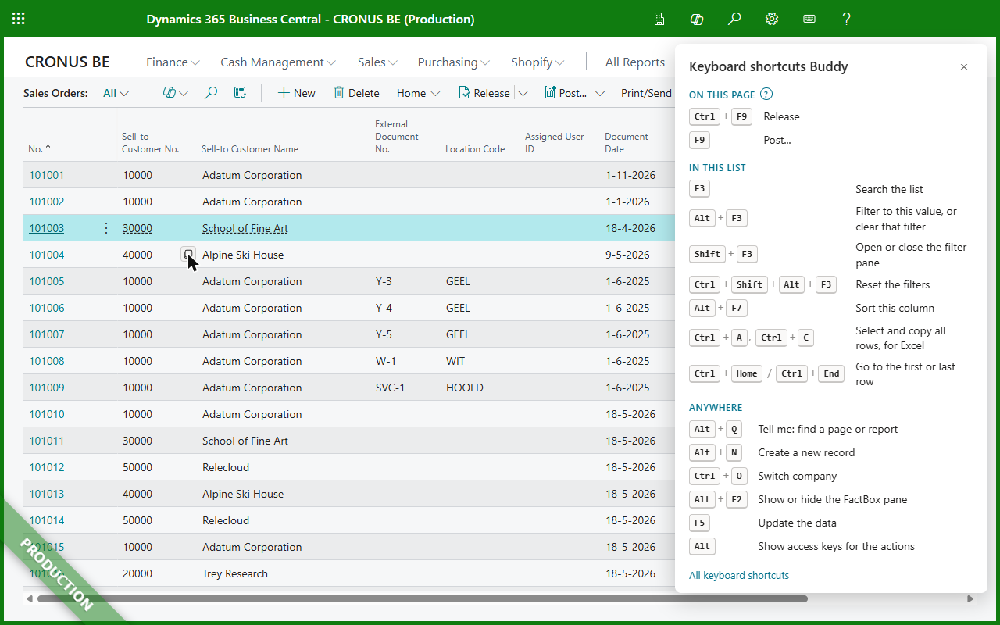
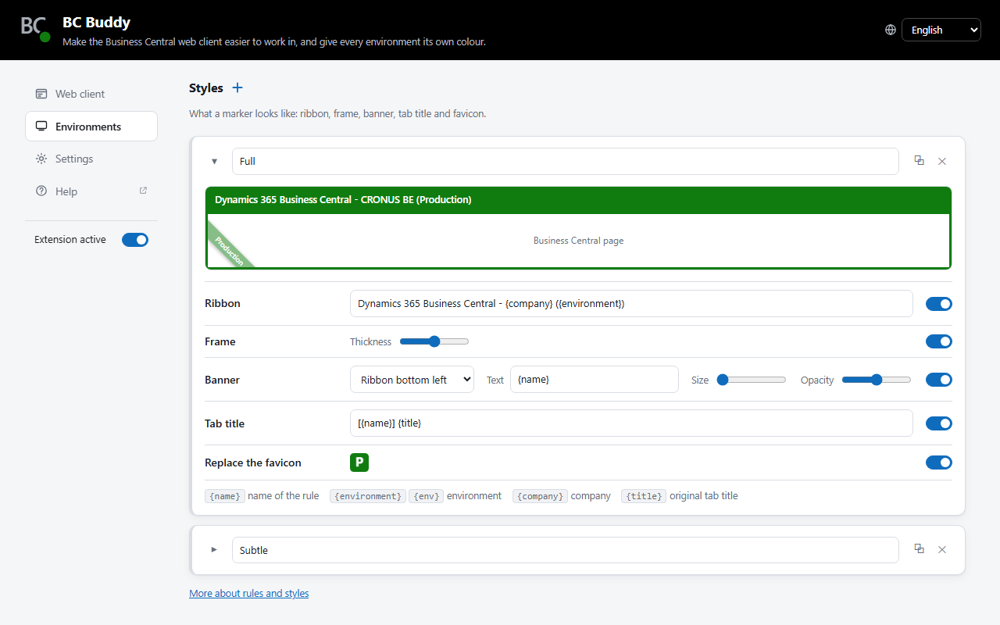

# BC Buddy

> **Business Central, easier to work in** ✨

BC Buddy is a free extension for Chrome and Edge. It makes the Business Central
web client easier to work in, and gives every environment its own colour, so
you never post in production by mistake.

- **An easier web client**, straight away: copy any value with one click, wide
  pages, bigger dropdowns, week numbers in the date picker and more.
- **A colour for every environment**: production green, sandbox red, or
  whatever suits you.

Full documentation: **<https://fvet.github.io/bcbuddy/>** · What's new in each
version: [CHANGELOG.md](CHANGELOG.md)

## 📥 Installing

Install it from the
[Chrome Web Store](https://chromewebstore.google.com/detail/bc-buddy/jpgpcfecpdcocjlepdfceahamliimjdl)
and click **Add to Chrome**. Edge first asks whether to allow extensions from
other stores; say yes. You need Chrome or Edge 111 or newer.

## 🚀 Getting started

1. **Install BC Buddy.** Its settings page opens by itself. Later, click the
   BC Buddy icon in the toolbar to open it again, or in Business Central click
   the gear icon at the top right and choose **Settings** under **BC Buddy**.
2. **Open Business Central**, or reload a tab where it was already open. The
   web client improvements below are already working.
3. **Give your environments a colour.** On the settings page, go to
   **Environments** and click **Load samples**: Production turns green, test
   environments red. Or click **+** next to **Rules**, name it `PRODUCTION`, set the
   condition **Environment** **equals** `Production` and pick green.

Not sure what your environment is called? Open **Environments** while a
Business Central tab is open: BC Buddy reads that tab and shows its
environment and company at the top.

## 🖥️ Web client

No setup needed. Each improvement has its own switch under **Web client** on
the settings page.

| Improvement | What you get in Business Central | Starts |
|---|---|---|
|  **Copy values** | A copy icon on any value in a list or FactBox, and on links on a card | On |
|  **Maximize pages** | Every page in wide layout, tile pages as a list | On |
|  **Pin the action bar** | Every page opens with the row of actions under its tabs pinned | On |
|  **Dropdown size** | The list under a field as wide as its columns need, and taller if you like | On |
|  **Resize panes** | Drag Help, Copilot, Page Inspection and the Personalization field list wider or narrower | On |
|  **Week numbers in the date picker** | Business Central's own week numbers in the calendar of a date field; Shift+Home turns them off | On |
|  **Highlight the current line** | The line you are on in a journal or order stands out | On |
|  **Hide the notifications icon** | No bell in the top bar | On |
|  **Keyboard shortcuts** | A keyboard icon in the top bar that shows the shortcuts for where you are | Off |
|  **Striped rows** | Every other row in a list a light grey | Off |
|  **Hide the FactBox pane** | Pages open without the FactBox pane on the right, so the page gets the room | Off |
|  **Turn off animations** | Pages, dialogs and FastTabs appear at once instead of sliding in | Off |

**Reset to defaults**, above the list, puts every switch and slider back to
how BC Buddy starts out. When your team shares a file, the button reads
**Reset to your team's defaults** and takes the team's choices from that file.
Clicked by mistake? **Undo** sits right next to the message.

Looking for a dark theme or a blue light filter? BC Buddy leaves those to tools
that do them well: [Dark Reader](https://darkreader.org/) for dark mode, and
**Night light** in Windows for a warmer screen.

What each one does, in detail:
[Web client](https://fvet.github.io/bcbuddy/web-client/) on the website.

## 🎨 Environment colours

A test environment and the real one look exactly alike. BC Buddy colours the
bar at the top of Business Central, with your own text:

```
Dynamics 365 Business Central - CRONUS BE (Production)
```



You set this up with two lists under **Environments**:

- A **rule** says *which* environment gets *which colour*: a name, one or more
  conditions, a colour, and the letters on the tab icon.
- A **style** says *what* the marking looks like. Several rules can share one.
  You start with two: *Full* shows every marking, *Subtle* only colours the
  bar at the top. In Dutch they are *Volledig* and *Subtiel*, in French
  *Complet* and *Discret*.


### Rules

A condition looks at the web address of the page: **Environment** **equals**
`Production`, **Company** **equals** `CRONUS BE`, and so on. A rule with
several conditions applies only when all of them fit. To give several
environments the same colour, list them with commas: **Environment**
**contains** `DEV, UAT, QA`.

An address without an environment, such as
`businesscentral.dynamics.com/contoso.com`, opens your default environment:
BC Buddy reads it as **Production**.

The first rule that fits wins, so put specific rules (one customer's
production) above general ones (anything called Production).

<details>
<summary>What BC Buddy reads from a web address</summary>

| Field | From the address below |
|---|---|
| Url | the full address |
| Environment | `Sandbox` |
| Company | `CRONUS BE` |
| Tenant | `c1cf0fd8-6b50-4d5a-8627-9ea2c09c6811` |

```
https://businesscentral.dynamics.com/c1cf0fd8-6b50-4d5a-8627-9ea2c09c6811/Sandbox?company=CRONUS%20BE&page=1
```

Ways to compare: contains, equals, starts with, ends with, does not contain,
RegEx. **contains** and **does not contain** also take a list separated by
commas: the condition fits when any of them appears, or for **does not
contain**, when none of them does. A RegEx that is not valid, or so complex that checking it could slow
the page down, never matches; the condition then says why.

Business Central on your own server (on-premises) is recognised too: the
server instance sits where the environment would be (`/BC240/?company=...`)
and the tenant comes from the end of the address.

Rules apply on every website, because an on-premises address does not reveal
that it is Business Central. If a rule ever colours another website, add the
condition **Url** **contains** `businesscentral.dynamics.com`, or the name of
your own server.

</details>

### Samples

No rules yet, or not sure where to start? Click **Load samples** next to
**Rules**. You get four rules of your own, to change or delete like any
other:

| Rule | Colour | Fits when |
|---|---|---|
| **Master Data** | yellow | **Company** **contains** `masterdata, master data, template` |
| **Production** | green | **Environment** **contains** `production` |
| **UAT** | red | **Environment** **contains** `uat, test, qa, sandbox` |
| **Development** | blue | **Environment** **contains** `dev` |

Master Data comes first, so a master data company shows yellow even in
production. They use the *Full* style; pick *Subtle* on a rule for a quieter
marking. Rules you already have stay as they are: a sample with the same name is
skipped. Deleted a sample? Click **Load samples** again and it comes back in
its old place, and so does a missing *Full* or *Subtle* style. When your IT department installed BC Buddy or set a shared file,
the button is not there: your colours come from them.

### Styles

A style can show any of these:

- **Ribbon**: the bar at the top of Business Central, in the colour of the
  rule, with a text of your own.
- **Frame**: a coloured border around the window, 1 to 5 pixels wide.
- **Banner**: a bar along the bottom or a diagonal ribbon in a corner. At
  **Size** all the way left the text shrinks to fit; further right it is
  larger.
- **Tab title**: the name of the browser tab with a marking added, such as
  `[TEST] Company Information`.
- **Favicon**: a coloured tab icon with one or two letters.



The preview at the top shows the result while you change it, in the colour
and name of the rule that fits the address under **Test**, or in Business
Central's own colour when no rule fits. The text colour is *Automatic*: white or black,
whichever reads best on the colour.

In every text you can use these placeholders: `{name}` (the rule),
`{environment}` or `{env}`, `{company}` and `{title}` (the original tab
title). One that stays empty takes the dash or brackets next to it along, so
`{name} - {company}` shows just `PRODUCTION` on a page without a company.

## 👥 Sharing settings with your team

One person sets up the colours and everyone else gets them automatically.

**Using your team's file:** on the settings page, go to **Settings**, paste
the address you were given under **Shared configuration**, and click
**Synchronise**. BC Buddy checks for changes every day. Shared rules cannot be
changed; click the copy button on one to get your own version, which takes its
place. The **X** next to *Shared rules* stops using the file.

**Publishing a file:**

1. Click **Export to file**. That saves `bc-buddy.json`, with your rules, styles and
   **Web client** settings.
2. Put it somewhere everyone can open it over `https://`, such as a repository.
   An ordinary `github.com/.../blob/...` link works. Only use an address you
   control: the file decides what BC Buddy colours.
3. Give your team the address. To try it out first, use
   `https://fvet.github.io/bcbuddy/examples/bc-buddy.json`, the same file as
   [`examples/bc-buddy.json`](examples/bc-buddy.json), with the rules that
   **Load samples** adds.

The **Web client** settings in a shared file are a starting point. Each one is
applied on the first sync, and after that only when the team changes it in the
file, so a colleague who switches something off keeps it off. To share only
some of them, delete the others from the `webClient` part of the file; without
that part, everyone keeps their own. **Reset to your team's defaults** under
**Web client** brings a colleague back to what the file says.

**Import / export > Import from file** loads a file once: rules you already have are
overwritten, new rules are added, rules that are not in the file stay, and the
**Web client** settings in the file replace yours.

If your IT department set up BC Buddy for you, the address is already filled
in with *Set by your organisation*, and you cannot change it.

<details>
<summary><b>For IT: install BC Buddy on every computer with Intune</b></summary>

1. **Install silently.** In an Intune **Settings catalog** profile, set Edge's
   *Control which extensions are installed silently* and Chrome's *Configure
   the list of force-installed apps and extensions* to
   `jpgpcfecpdcocjlepdfceahamliimjdl;https://clients2.google.com/service/update2/crx`.
   Edge installs it from the Chrome Web Store too. A computer that gets BC
   Buddy this way does not open its settings page on first start.
2. **Set the shared file.** BC Buddy reads the string `sharedConfigUrl` from
   `HKLM\SOFTWARE\Policies\Microsoft\Edge\3rdparty\extensions\jpgpcfecpdcocjlepdfceahamliimjdl\policy`
   and the same path under `Google\Chrome`. The Settings catalog cannot write
   these keys: run
   [`Set-BCBuddyPolicy.ps1`](examples/intune/Set-BCBuddyPolicy.ps1) as a
   Platform script, or as a Remediation with
   [`Detect-BCBuddyPolicy.ps1`](examples/intune/Detect-BCBuddyPolicy.ps1)
   (Windows Enterprise E3/E5). Run it as system in 64-bit PowerShell. For
   Group Policy there is [`bc-buddy-policy.reg`](examples/intune/bc-buddy-policy.reg).
3. **Keep BC Buddy to Business Central (recommended).** Set Edge's
   *Configure extension management settings* and Chrome's *Extension
   management settings* to
   [`extension-settings.json`](examples/intune/extension-settings.json), with
   your own on-premises server and the host of your shared file in
   `runtime_allowed_hosts`. `*://*` in `runtime_blocked_hosts` keeps BC Buddy
   off every other website. The policy is one value for all extensions, so
   merge this entry into any value you already have.
4. **Check it** in `edge://policy` or `chrome://policy` on a test computer,
   then roll out to a pilot group first.

The address is then locked on the settings page and the shared rules cannot be
cleared. BC Buddy loads the file straight away. If that fails, it tries again
after 1, 2, 4 and 8 hours, then once a day; once it loads, it checks daily. Removing the policy unlocks the field and keeps the rules.
The address must be `https://` and readable without signing in, so not behind a
SharePoint or OneDrive login.

**If something goes wrong.** To stop one feature, set it to
`"enabled": false` under `webClient` in the shared file. Computers pick it up
at browser start or within a day, and open tabs follow without a reload. It is
switched off once, not locked, and leaving a setting out of the file changes
nothing. To stop BC Buddy as a whole, remove it from the silent-install list
and add `jpgpcfecpdcocjlepdfceahamliimjdl` to Edge's *Control which extensions
cannot be installed* and Chrome's *Configure extension installation
blocklist*; both are needed, because the install list wins. That arrives at the
next Intune check-in. Rules and settings people made themselves may not
survive; the shared file's come back when you undo it.

</details>

## 🛟 Troubleshooting

**Nothing changed after installing.** Reload the Business Central tab (F5), and
check that **Active**, below the menu on the left of the settings page, is on.

**No copy icon on a value.** Rest the mouse on it for a moment. Fields you can
type in get no icon on purpose: select the text and press Ctrl+C.

**A page stays narrow or in tiles.** Maximize pages only changes a page nobody
set yet. Once a page was set back to narrow or to tiles in this browser,
Business Central remembers that and BC Buddy leaves it. Click the wide toggle
or pick list view once, and Business Central remembers that instead.

**The action bar floats on a page.** Pin the action bar likewise only pins a
page nobody set yet. Click the pin at the right end of the action bar once, and
Business Central keeps it pinned from then on.

**The FactBox pane stays open on a page.** **Hide the FactBox pane** starts
off; switch it on under **Web client**. It then only closes the pane on a page
you open for the first time in this browser: Business Central stores the pane
together with wide layout, so a page you used before keeps its pane. Close it
once on that page, and Business Central keeps it closed from then on.

**A pane will not get wider.** Only Help, Copilot, Page Inspection and the
Personalize field list get the handle; the FactBox pane has Business Central's
own. Point at the very left edge until the pointer turns into a double arrow.
Double-click the edge for Business Central's own width again.

**No keyboard icon in the top bar.** **Keyboard shortcuts** starts off; switch
it on under **Web client**, and reload the tab. Business Central on your own server
has no room for the icon; set a key for the panel at
`chrome://extensions/shortcuts` instead.

**No week numbers in the date picker.** Press Shift+Home while the calendar is
open: that turns Business Central's week numbers on or off, and someone may
have turned them off that way. Business Central remembers it, and BC Buddy
leaves it.

**A dropdown keeps its usual size.** A field with a **…** button (City, Post
Code) opens a whole page, not a dropdown. A list with two short columns needs
no extra width.

**Nothing is coloured.** Open **Environments** with your Business Central tab
still open. The rule that tab gets has a border all round in its colour; no
such border means none of your rules fits it.

**The bar at the top keeps its usual colour.** BC Buddy finds that bar by its
text, *Dynamics 365 Business Central*. Where it reads differently, the frame,
banner, tab title and tab icon still mark the environment.

**Something stopped working after a Business Central update.** BC Buddy leaves
a part of Business Central alone rather than break it when Microsoft changes
it. Please [open an issue](https://github.com/fvet/bcbuddy/issues) so it can
catch up.

More on the website: [Troubleshooting](https://fvet.github.io/bcbuddy/troubleshooting/).

## 🌍 Languages

BC Buddy is in English, Dutch and French, and follows the language of your browser.
To use another one, pick it in the language list at the top right of the BC Buddy
settings. Business Central keeps its own language. The texts you type yourself in a rule or style appear exactly as you type
them. Would you like it in your own language? See
[TRANSLATING.md](TRANSLATING.md).

## 🔒 Privacy

Everything stays on your own computer. No server, no account, no tracking. The
only thing BC Buddy ever downloads is your team's shared file, from the address
you enter yourself. Full text in [PRIVACY.md](PRIVACY.md).

## 🛠️ For developers

Working on the extension itself is covered in [DEVELOPMENT.md](DEVELOPMENT.md).
To run it from source: open `chrome://extensions` (or `edge://extensions`), turn
on **Developer mode**, click **Load unpacked** and pick a clone of this
repository or an unpacked `bcbuddy-*.zip` from the
[releases page](https://github.com/fvet/bcbuddy/releases/latest).

## 📄 Licence

MIT — the full text is in [LICENSE](LICENSE). Use it, change it and pass it on,
inside a company as well; the copyright notice and the licence text have to
travel with it.

## ⚖️ Disclaimer

BC Buddy is an independent open-source project. It is not affiliated with,
endorsed by or supported by Microsoft. Microsoft, Dynamics 365 and Business
Central are trademarks of the Microsoft group of companies.

BC Buddy is provided as is, without warranty of any kind, and its authors are
not liable for any damage that comes from using it. The full terms are in
[LICENSE](LICENSE).
